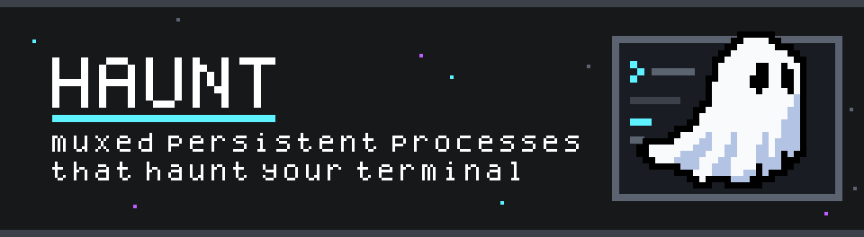

<p align="center">
  
</p>

---

https://github.com/user-attachments/assets/b64e2569-c693-4637-a6a9-f3e267d9d10e

`haunt` is a small terminal multiplexer for Ghostty. It runs a main shell and lets you summon configured apps with direct keybinds. Hide an app and it keeps running; bring it back and pick up where you left off.

Each Ghostty tab runs its own haunt process. Apps persist while that process is running, independently of programs such as Neovim in the main shell. `haunt` is not a detachable session manager: exiting the main shell or closing the tab ends the session and shuts down its apps.

`haunt` uses libghostty-vt to parse each pane and render it in the outer terminal, with support for features such as Kitty graphics and progress reporting.

## why?

I live in the terminal, and mostly in neovim. I loved [toggleterm.nvim](https://github.com/akinsho/toggleterm.nvim) and its natural successor, [snacks.nvim](https://github.com/folke/snacks.nvim): being able to jump in and out of a terminal buffer for a specific app or task, without ever leaving my editor, is a great workflow. However, there were a couple problems:

- The apps I launched from Neovim lived and died with it. Closing neovim killed the process.
- Embedded terminals had limited support for features like kitty graphics, progress reporting and other OSC sequences.

I wanted to keep the per-app keybinds, but give each app a full-featured terminal that outlives whatever I'm doing in the main pane. Enter `haunt`.

## usage

Run `haunt` inside Ghostty. Your shell opens as the main pane. On first run, haunt creates `~/.config/haunt/config.toml` with a default configuration. Edit it to add your own apps and bindings, then press `ctrl+shift+r` to reload.

Press a binding to start and show its app; press it again to hide it. Only one app is visible at a time, but hidden apps continue running. Switching to another app hides the previous one. If an app exits, its next invocation starts a fresh process. New apps start in the main pane's current working directory when it can be determined.

A half-size app appears to the right of the main pane; a full-size app covers it. Click a pane to focus it.

Press `ctrl+shift+h` to show your configured apps and bindings. Press `ctrl+shift+r` to reload the configuration. Help and other notifications stack and disappear after five seconds; press Esc to dismiss them early.

<table align="center">
    <tr>
        <td>
            
        </td>
        <td>
            
        </td>
    </tr>
</table>

## configuration

Create `~/.config/haunt/config.toml` (or `$XDG_CONFIG_HOME/haunt/config.toml` when `XDG_CONFIG_HOME` is absolute):

```toml
# Optional; defaults to your account shell, then $SHELL, then /bin/sh.
shell = ["nu", "-l"]
# Optional; defaults to ctrl+shift+r. Must not conflict with other bindings.
reload_bind = "ctrl+shift+r"
# Optional; defaults to ctrl+shift+h.
help_bind = "ctrl+shift+h"
# Optional; defaults to a space. Must be one printable, one-cell character.
separator = "│"
# Optional; defaults to true. Show the launch banner: the ghost and the machine lines.
banner = false

[[app]]
name = "pi"
bind = "ctrl+shift+p"
cmd = ["pi"]
size = "half"

[[app]]
name = "lazygit"
bind = "ctrl+alt+g"
cmd = ["lazygit"]
size = "full"

[[app]]
name = "term"
bind = "ctrl+\\"
cmd = ["nu", "-l"]
```

Include every app you want to use in the config. `size` defaults to `half`; `full` is the other option. Commands are arrays of the executable and its arguments, not shell command strings. App names and bindings must be unique. Bindings support `ctrl`, `alt` (also `option`/`opt`), `shift`, and `super` modifiers, plus keys such as letters, `space`, `enter`, arrow keys and `f1`–`f24`. On macOS, Option is reported as Alt only when the outer terminal sends it that way (in Ghostty, `macos-option-as-alt = true`); otherwise Option produces a composed character that cannot be used as a modifier.

## installation

Prebuilt binaries are attached to [GitHub Releases](https://github.com/scottmckendry/haunt/releases) for `x86_64` and `aarch64` Linux, plus Intel and Apple Silicon macOS. To install the latest release:

```sh
curl -fsSL https://github.com/scottmckendry/haunt/releases/latest/download/haunt-installer.sh | sh
```

Each release includes per-archive `.sha256` files and a `sha256.sum` covering the release archives. To verify a downloaded archive:

```sh
sha256sum -c sha256.sum
```

On macOS, use `shasum -a 256 -c sha256.sum` instead.

## building

The Nix flake provides packages and development shells for `x86_64` and `aarch64` Linux, plus Apple Silicon macOS:

```sh
nix build
./result/bin/haunt
```

Alternatively, enter `nix develop` and run `cargo run` or `cargo build --release`. Outside the Nix shell, building needs Rust and either a compatible libghostty-vt 1.0 via pkg-config or Zig 0.17.x to build the pinned upstream source. The bindings prefer any library found by pkg-config without checking its version: remove older libghostty-vt installations from the pkg-config search path before building.
